## Requested Feedback

::: {.nonincremental}
* Gaps in the analysis?
* Which results/methods to emphasize?
:::

## Cognitive Neuroscience

:::: {.columns}

::: {.column width="50%"}
::: {.image-card}
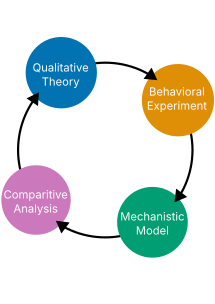{style="height: 480px; width: auto;"}
:::
:::

::: {.column width="50%"}
::: {.image-card}
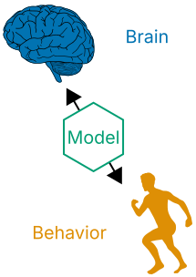{style="height: 480px; width: auto;"}
:::
:::

::::

## Evidence Integration

::: {.image-card}
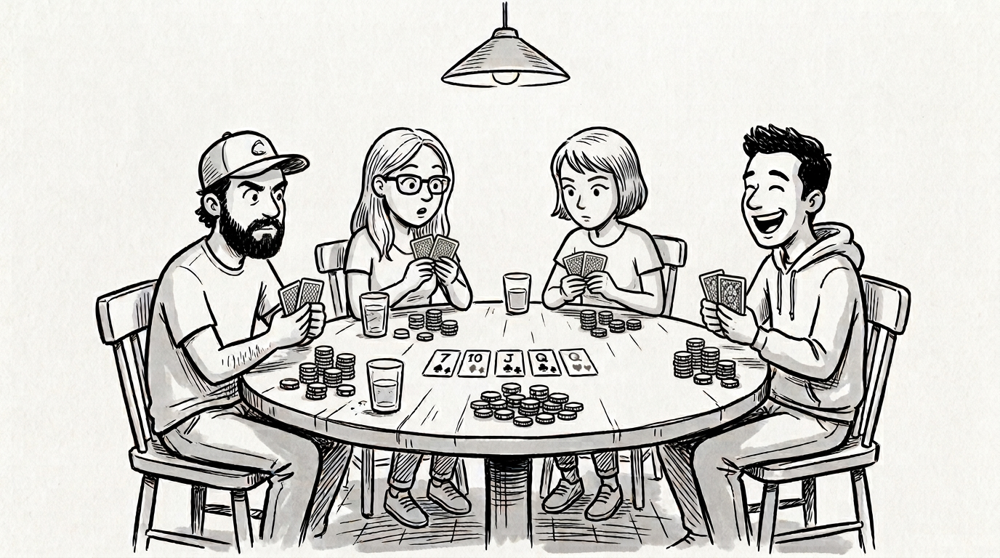{width="100%"}
:::

## Behavioral Experiments

::: {.image-card}
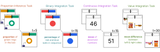{width="100%"}
:::

<!--
## People Learn as they Gather Data

::: {.image-card}
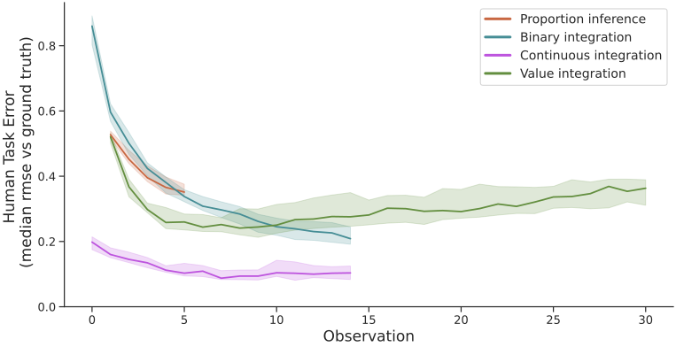{width="100%"}
:::
-->

## Cognitive Models

::: {.image-card}
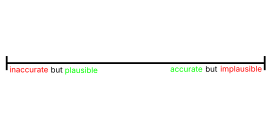{#theories-img width="100%"}
:::
[]{.fragment fragment-index="1" data-swap-target="theories-img" data-swap-src="figures/cognitive_models_1.svg" data-swap-prev="figures/cognitive_models_0.svg"}
[]{.fragment fragment-index="2" data-swap-target="theories-img" data-swap-src="figures/cognitive_models_2.svg" data-swap-prev="figures/cognitive_models_1.svg"}
[]{.fragment fragment-index="3" data-swap-target="theories-img" data-swap-src="figures/cognitive_models_3.svg" data-swap-prev="figures/cognitive_models_2.svg"}
[]{.fragment fragment-index="4" data-swap-target="theories-img" data-swap-src="figures/cognitive_models_4.svg" data-swap-prev="figures/cognitive_models_3.svg"}
[]{.fragment fragment-index="5" data-swap-target="theories-img" data-swap-src="figures/cognitive_models_5.svg" data-swap-prev="figures/cognitive_models_4.svg"}

## DPE Theory and Network

::: {.image-card}
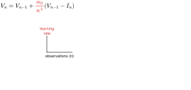{#models-overview-img width="100%"}
:::

[]{.fragment fragment-index="1" data-swap-target="models-overview-img" data-swap-src="figures/models_overview_presentation_1.svg" data-swap-prev="figures/models_overview_presentation_0.svg"}
[]{.fragment fragment-index="2" data-swap-target="models-overview-img" data-swap-src="figures/models_overview_presentation_2.svg" data-swap-prev="figures/models_overview_presentation_1.svg"}
[]{.fragment fragment-index="3" data-swap-target="models-overview-img" data-swap-src="figures/models_overview_presentation_3.svg" data-swap-prev="figures/models_overview_presentation_2.svg"}

## Model Captures Behavior

::: {.image-card}
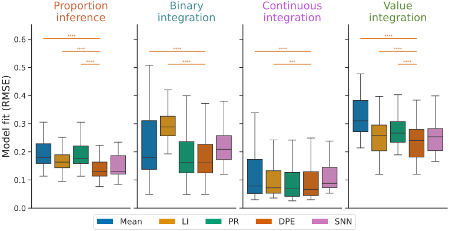{width="100%"}
:::

## Smaller Updates Over Time ($\lambda$)

::: {.image-card}
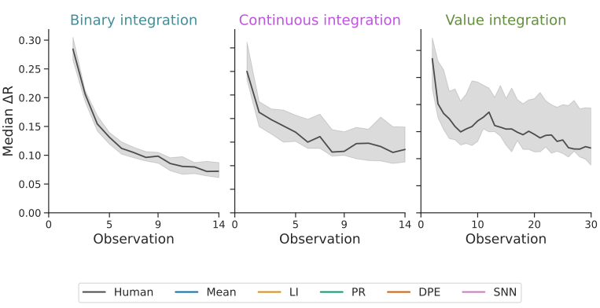{#lambda-response-change-img width="100%"}
:::

[]{.fragment fragment-index="1" data-swap-target="lambda-response-change-img" data-swap-src="figures/lambda_response_change.svg" data-swap-prev="figures/lambda_response_change_e.svg"}

## Individual Differences in $\lambda$

::: {.image-card}
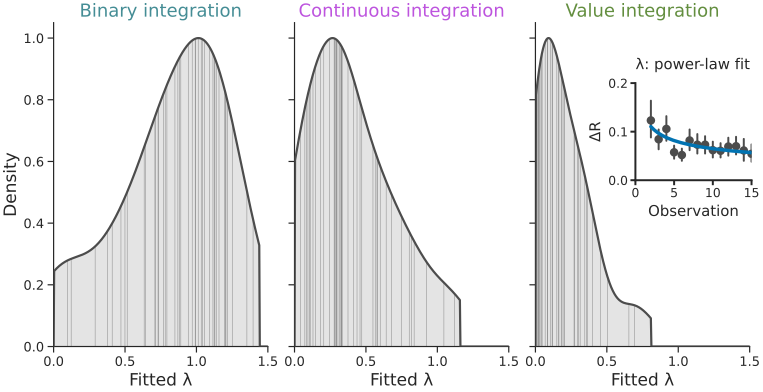{width="100%"}
:::

## People have Noisy Responses ($\sigma$)

::: {.image-card}
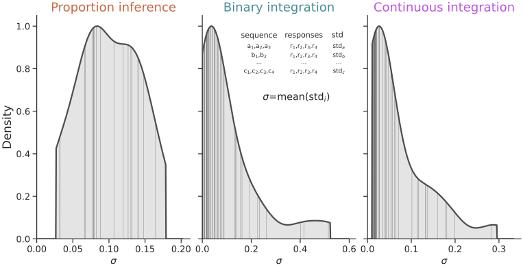{width="100%"}
:::

## Response Noise Dynamics

::: {.image-card}
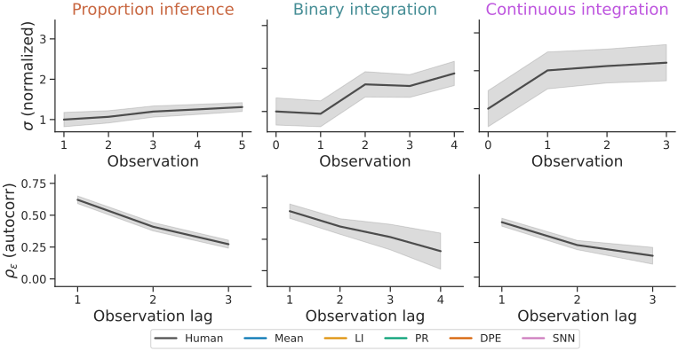{#sigma-growth-autocorr-img width="100%"}
:::

[]{.fragment fragment-index="1" data-swap-target="sigma-growth-autocorr-img" data-swap-src="figures/sigma_growth_autocorr_e.svg" data-swap-prev="figures/sigma_growth_autocorr_e2.svg"}
[]{.fragment fragment-index="2" data-swap-target="sigma-growth-autocorr-img" data-swap-src="figures/sigma_growth_autocorr.svg" data-swap-prev="figures/sigma_growth_autocorr_e.svg"}

## $\lambda$/$\sigma$ Consistent in/across Tasks

::: {.image-card}
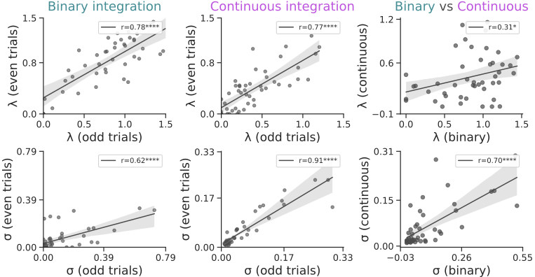{width="100%"}
:::

## Outlier Experiment

::: {.image-card}
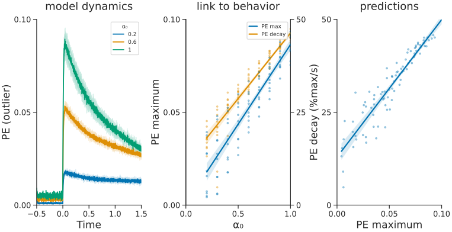{width="100%"}
:::

## Decline in Updating

::: {.image-card}
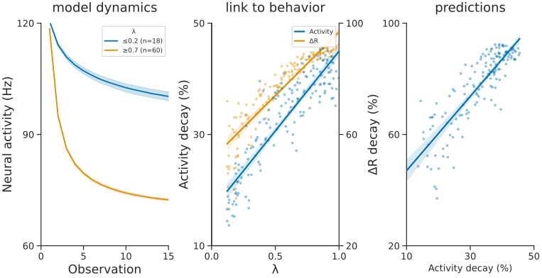{width="100%"}
:::

## Neural and Behavioral Noise

::: {.image-card}
{width="100%"}
:::

## Neural Mechanisms of WM

::: {.image-card}
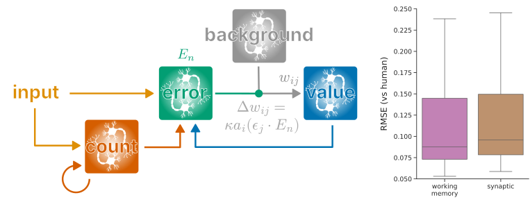{width="100%"}
:::

## Non-Invasive Stimulation

::: {.image-card}
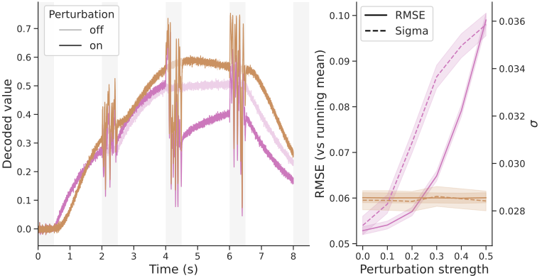{width="100%"}
:::

## Future Work

:::: {.columns style="display: flex; gap: 2em;"}

::: {.column width="33%"}
::: {.image-card}
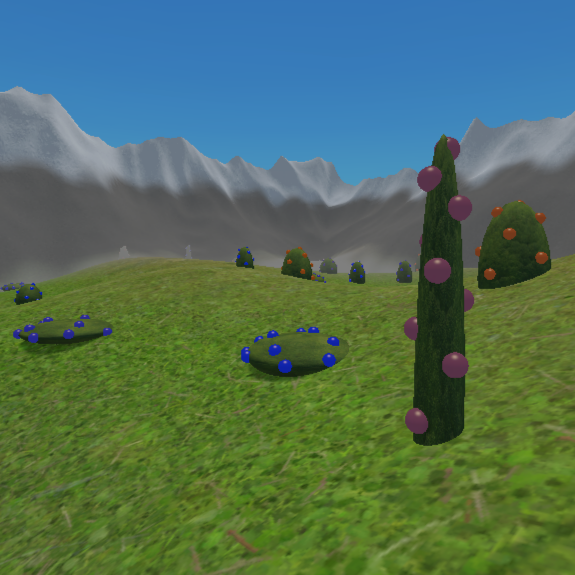{style="height: 200px; width: 200px; object-fit: cover;"}
:::

::: {style="text-align: center;"}
**Naturalistic VR Foraging**
:::

::: {.nonincremental style="font-size: 0.7em;"}
* Continuous time & space
* Multidimensional stimuli
* Explore vs exploit
:::
:::

::: {.column width="33%" .fragment}
::: {.image-card}
{style="height: 200px; width: 200px; object-fit: cover;"}
:::

::: {style="text-align: center;"}
**Sophisticated Neural Agent**
:::

::: {.nonincremental style="font-size: 0.7em;"}
* Episodic memory
* Successor representations
* Retrospective learning
:::
:::

::: {.column width="33%" .fragment}
::: {.image-card}
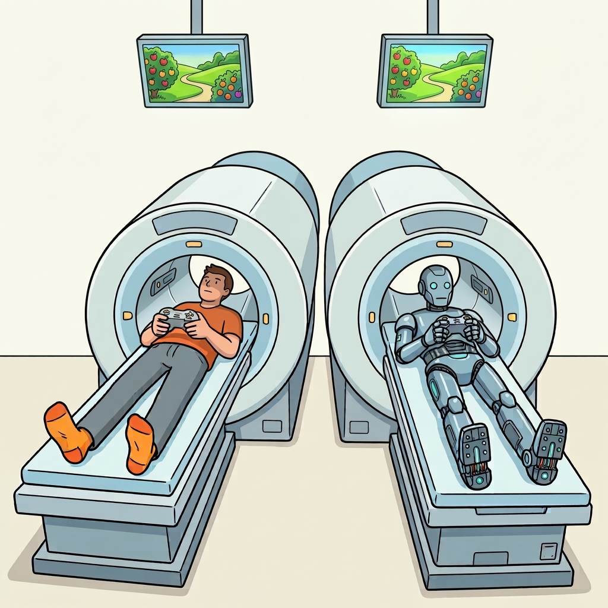{style="height: 200px; width: 200px;"}
:::

::: {style="text-align: center;"}
**Neural Analysis**
:::

::: {.nonincremental style="font-size: 0.7em;"}
* Recordings during task
* Agent vs human activity
* Profit
:::
:::

::::

## Acknowledgments {.smaller}

::: {style="display: flex; justify-content: space-evenly; width: 100%; min-width: 100%; box-sizing: border-box;"}
{style="height: 110px; width: 110px; object-fit: cover; border-radius: 8px;"}
{style="height: 110px; width: 110px; object-fit: cover; border-radius: 8px;"}
{style="height: 110px; width: 110px; object-fit: contain;"}
{style="height: 110px; width: 110px; object-fit: cover; border-radius: 8px;"}
{style="height: 110px; width: 110px; object-fit: cover; border-radius: 8px;"}
:::

Neural Engineering Framework

::: {style="font-size: 0.6em;"}
Eliasmith, Chris, and Charles H Anderson. 2003. Neural Engineering: Computation, Representation, and Dynamics in Neurobiological Systems. Cambridge, MA: MIT press.
:::

Proportion Inference Task / Data

::: {style="font-size: 0.6em;"}
Prat-Carrabin, Arthur, and Michael Woodford. 2024. “Imprecise Probabilistic Inference from Sequential Data.” Psychological Review 131.
:::

Value Integration Task / Data

::: {style="font-size: 0.6em;"}
Yoo, Minhee, Giwon Bahg, Brandon Turner, and Ian Krajbich. 2025. “People Display Consistent Recency and Primacy Effects in Behavior and Neural Activity Across Perceptual and Value-Based Judgments.” Cognitive, Affective, & Behavioral Neuroscience 25.
:::